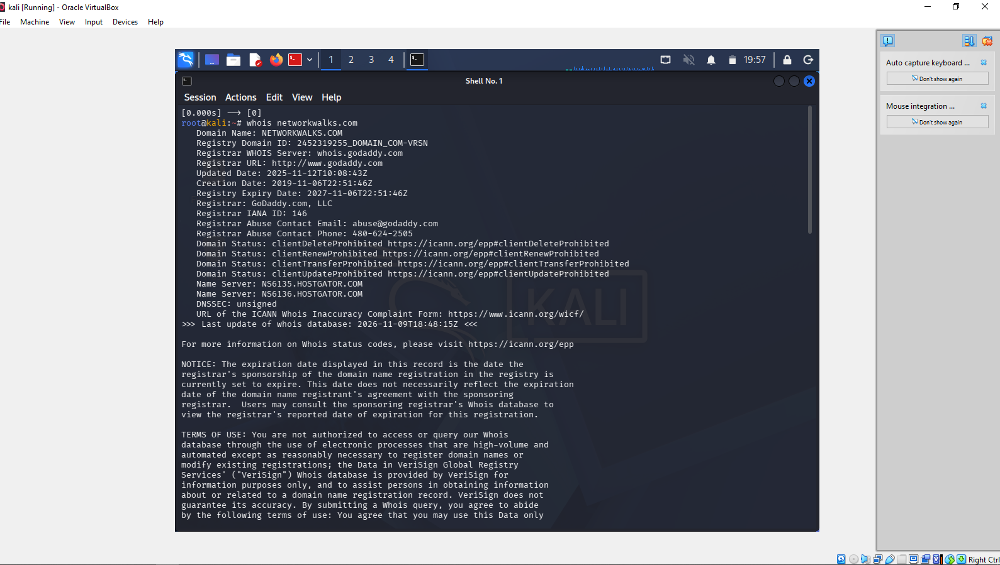
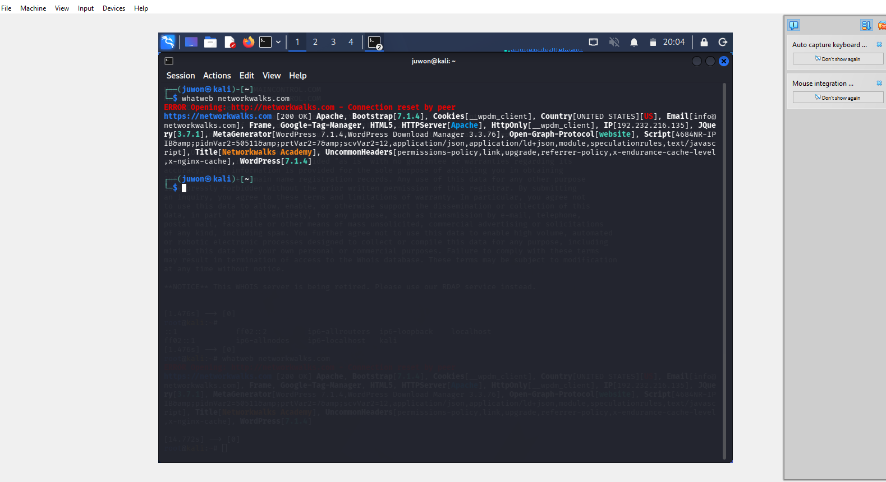
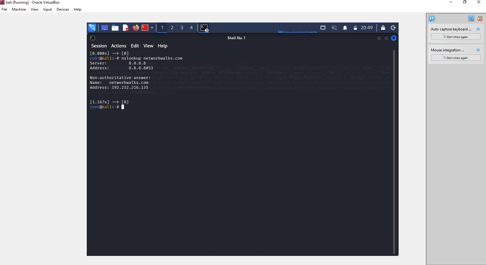
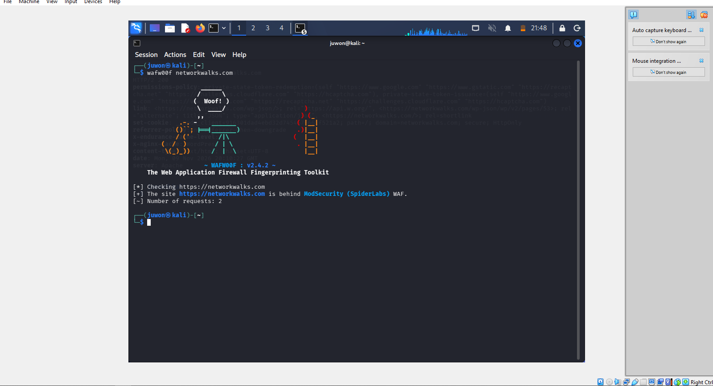
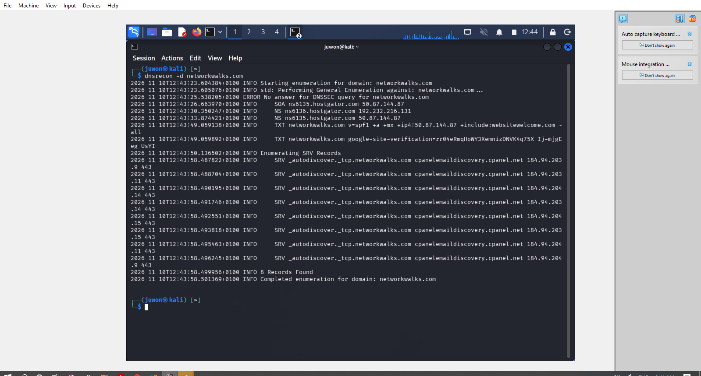
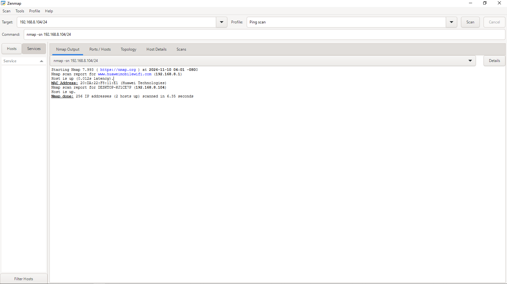
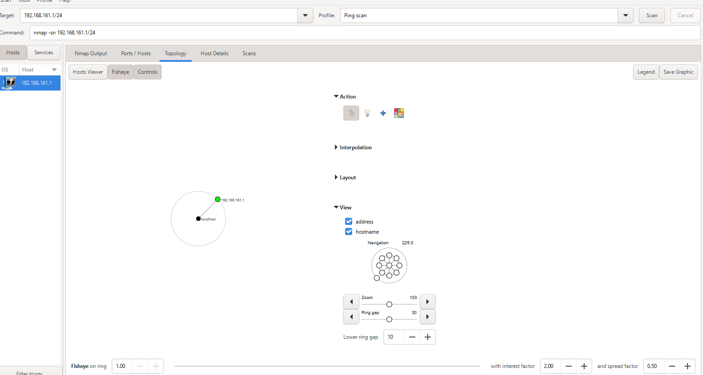

# NETWORKWALKS-B084-WK2-FOOTPRINTING-SCANNING
practical  experience on active and passive web footprinting, DNS enumeration, subnet scanning ARP interrogation, and topology mapping  networkwalks Week2  
## Footprinting & Network Scanning Report

## Description & Overview
This report documents the practical security analysis executed during Week 2 (W2-PM1 and W2-PM5) under the Networkwalks Cybersecurity Internship Program. All testing was executed in full compliance with explicit authorization within scoped target environments (networkwalks.com and isolated virtual lab subnets). The primary objective was to perform passive and active domain reconnaissance, gather target infrastructure metadata, discover active hosts on local subnets, analyze host routing, map network topology, and extract physical MAC identifiers via ARP table interrogation. Unapproved distribution or misuse of this technical data is strictly prohibited.
#  Reconnaissance & Network Scanning Report

Final Week 2 project report for the **Networkwalks** cybersecurity program, documenting Phase 1 (Reconnaissance & Footprinting) and Phase 2 (Scanning & Network Discovery) using Kali Linux tools and Zenmap.

---

## 🚧 Project Overview

| Field | Detail |
|---|---|
| **offensive security analyst** | Lagundoye Juwon Akeem |
| **Program / Batch** | Networkwalks-B084 |
| **Date** | 9th November, 2026 |
| **Modules Completed** | W2-PM1 (Multiple Kali Tools), W2-PM5 (Zenmap Scanning) |
| **Client / Target** | 1. Networkwalks (written permission secured) 2. Personal local LAN network |
| **Permission Secured from Client?** | Yes |
| **Phases Covered** | Phase 1: Reconnaissance & Footprinting Phase 2: Scanning & Network Discovery |

---

## 🎯 1. Liability Disclaimer

The activities documented in this report were conducted strictly on systems and devices for which prior written authorization was obtained, or on personally owned hardware. The contents of this document are intended strictly for educational and research purposes. The instructor, author, and Networkwalks assume no liability for the misuse or misapplication of this knowledge; all subsequent actions taken by the reader are their sole responsibility.

Unauthorized system access constitutes a criminal offense in most jurisdictions, regardless of whether data or systems are damaged, and can result in severe legal penalties, significant fines, career impact (employment termination), and a permanent criminal record.

> ⚠️ **Note:** Authorization must be secured from Networkwalks before performing reconnaissance and footprinting.

## ☄️ 2. Introduction 

As part of my Networkwalks internship program (week 2), this report provides a comprehensive analysis of the Footprinting/Reconnaissance phases targeting the networkwalks.com domain and subsequent scanning of the local network utilizing Zenmap. By leveraging a combination of Kali Linux tools and Zenmap, this assessment simulates how a malicious actor actively maps live network hosts. The methodology mirrors an attacker's lifecycle, transitioning from passive data gathering (W2-PM1) to active host discovery (W2-PM5).

## 💡 Footprinting

All footprinting commands were executed within a Kali Linux environment.

## 🔎 Scanning activities

Were performed via Zenmap on a windows host (pc).

## 📝 Methodology, analysis framework, and documentation

To ensure reproducibility and rigorous documentation, every technical step outlines the exact commands utilized, corresponding system output, verification screenshots, and a brief analytical note from the attackers point of view regarding the security implications of the exposed data.

## ⚒️ 3. Tools Used
Each tool used and its purpose can be found in the table below.
---
|Tool/commands |	Purpose|
|---|---|
|**Kali Linux**|Operating system deployed to conduct initial reconnaissance and information gathering.|
|**Windows OS**|	Host Operating systems utilized for networking activities including network mapping via Zenmap.|
|**WHOIS**|	Queries or Finds domain registration details such as registration ownership, critical dates, and authoritative name servers.|
|**whatweb**|	Identifies and fingerprints web technologies, including servers, CMS - content management system, plugins, and IP.|
|**nslookup**|	Performs DNS lookup to resolve target domain names to their respective IP address|
|**curl -I**|	Fetches, analyses, and reads the HTTP response headers of the website.|
|**wafw00f**|	Probes the web application to detect the presence and type of Web Application Firewall (WAF) present.|
|**dnsrecon**|	Enumerate or discovers all DNS records (NS, MX, SPF, TXT, SRV).|
|**Zenmap (Nmap GUI)**|	Scan the local subnet to find live hosts, active IP addresses, and MAC addresses.|
|**Windows CMD**|	Local IP and MAC address identification via a command line interface.|

---

## 🛡️Activities Performed

## 4. Footprinting & Reconnaissance Attacks With Multiple Kali Tools
## 4.1. Background
Reconnaissance (also called as footprinting) is the first step in any real attack or security test. Before touching a target, an attacker quietly collects as much public information about it as possible. This includes who owns the domain, its real IP address, the hosting provider, the web technologies it runs, its DNS and mail records, and whether a firewall is protecting it. All of this comes from information the target has already made public, so the target never even knows it is being studied. This is why recon is powerful and very hard to detect.

> **⚠️** In this lab, the live website networkwalks.com was footprinted.

## 💡4.2. Footprinting & Reconnaissance
I performed reconnaissance against the networkwalks.com domain using six Kali Linux commands:

`dnsrecon`
`nslookup`
`whatweb`
`curl -I`
`whois`
`Nmap/Zenmap`

> **⚠️** Note: Each tool was used to collect a different type of information about the target as seen in table 3 above.

## 4.2.1. WHOIS
WHOIS was used to obtain publicly available domain registration information and identify the domain’s name servers. The results provided information about the domain registration and hosting infrastructure.
>  Command used: `whois networkwalks.com`

## 4.2.2. Whatweb
WhatWeb was used to identify and fingerprint technologies used by the website.
> Command used: whatweb networkwalks.com

## 4.2.3 Nslookup
Nslookup was used to resolve the targets domain name to its IP address. The provided result identified 192.232.216.135.

> Command used: `nslookup` `networkwalks.com`; OR, $ `nslookup -vc` `networkwalks.com` `8.8.8.8`

## 4.2.4 curl
Curl was used with the -I option to inspect the HTTP response headers. This provided additional information about the web application and exposed the WordPress REST API endpoint /wp-json/.
> Command used:` curl -I https://networkwalks.com`

4.2.5 Wafwoof
wafwoof was used to determine whether a Web Application Firewall was protecting the website. The result identified ModSecurity (SpiderLabs) Web Application Firewall.

> Command used: `wafwoof` `networkwalks.com`

## 4.2.6 dnsrecon
dnsrecon was used to enumerate DNS records. The results provided information relating to name servers, mail servers, SPF/TXT records, service records and DNS software information.
> command used: `dnsrecon -d` `networkwalks.com`

## 5. Network Scanning with Zenmap
## 5.1. Background
Zenmap is the official GUI version of Nmap which can be used on Windows PC. It is a security scanner software tool which is used by Cybersecurity professionals & Hackers. It is a multi-platform (Linux, Windows, Mac OS X, BSD, etc.) free and open source application which aims to make Nmap easy for beginners to use while providing advanced features for experienced Nmap users. Frequently used scans can be saved as profiles to make them easy to run repeatedly.

## 5.2. Introduction and Objectives
For this second activity, I used Zenmap to perform network discovery on my local network. This practical required me to:

a). Identify my local IP address and subnet
b). Discover live hosts
c). Identify their IP addresses
d). Identify their MAC addresses
e). Generate a network topology

## 5.2.1. Procedure
The Windows ipconfig command was entered in my cmd prompt to identify my local IP address and LAN subnet.
I then entered the subnet into Zenmap and selected Ping Scan to identify active hosts.

. The example results also included two MAC addresses.
See images below:

## 🎯 6. Risk Analysis / Impact
Based on the information collected during the footprinting and network scanning activities, I identified the following potential risks.
---
## Risk Analysis / Impact

Based on the information collected during the footprinting
and network scanning activities, I identified the following
potential risks.

| No. | Risk / Finding | Evidence / Observation | Potential Impact | Risk Level |
|-----|----------------|------------------------|------------------|------------|
| 1 | Web technology information exposed | WhatWeb identified WordPress and WP Download Manager | Attackers may use exposed technology information to identify software requiring further security review | 🟡 Medium |
| 2 | Server IP address identifiable | Nslookup resolved the domain to 192.233.216.135 | Provides information about the network location of the web service | 🟢 Low |
| 3 | HTTP technical information exposed | Curl returned HTTP response headers and exposed /wp-json/ | May assist technology fingerprinting and further enumeration | 🟢 Low |
| 4 | WAF technology identifiable | WhatWAF identified ModSecurity | Reveals information about the web application's security architecture | 🟢 Low |
| 5| DNS infrastructure information exposed|	DNSRecon identified DNS, mail and service-related records|	DNS information can help build a broader infrastructure profile|	🟡 Medium|
|6| Multiple live hosts visible on local network|	Zenmap identified four live hosts in the example network|	Unknown or unauthorized devices may potentially be present on a network|	🟡 Medium|
---

---
## Risk Rating Key

| Indicator | Severity |
|---|---|
| 🔴 | Critical|
| 🟡 | Medium |
| 🟢| Low|
---
> ⚠️ Note: The risks above are observations from the footprinting and scanning exercises, not confirmed vulnerabilities. The practical exercises primarily involved information gathering and host discovery. No exploitation or vulnerability validation was performed as part of these two modules. Therefore, the presence of information such as a software version, IP address or DNS record does not by itself mean that the system is vulnerable. Further authorized security testing would be required to confirm any actual vulnerability.

## 🛡️ 7. Recommendations
## Based on the observations from these activities, I recommend the following security improvements:
# Review publicly exposed technology information
Organizations should regularly review what information about their web technologies, CMS and plugins is publicly visible.

## Keep software updated
CMS platforms, plugins and other web technologies should be regularly updated and reviewed against current security advisories.

## Review HTTP headers
HTTP response headers should be reviewed to determine whether unnecessary technical information is being exposed.

## Review DNS records regularly
DNS records should be checked periodically to ensure that only required information and services are publicly exposed.

## Properly configure and monitor the WAF
Keep the WAF (ModSecurity) enabled and tuned, since it already blocks naive attacks.

## Perform regular internal network discovery
Organizations should periodically scan their own networks to identify active devices.

## Investigate unknown devices
Any unexpected device discovered during network scanning should be investigated and verified.

## Maintain network documentation
Network topology and device information should be documented and updated regularly.

## Perform security testing with authorization
All Reconnaissance and scanning should only be performed against systems and networks where appropriate authorization has been provided.

---
## 8 Security Assessment Summary

| Category | Status |
|---|---|
| 🔎 Reconnaissance and Footprinting | ✔️ Completed|
| 🌐 Network Discovery |  ✔️ Completed|
|👨🏽‍💻 Host Identification | ✔️ Completed |
|⏳ Network Topology | ✔️ Completed|
|💥 Exploitation | ✔️ Completed|
---

## 🔚 10. Conclusion
During Week 2 of my Cybersecurity & Ethical Hacking internship, I completed authorized educational labs covering footprinting, reconnaissance, and network scanning.

Using Kali Linux tools (such as` WHOIS`, `whatweb`, `nslookup`, `wafwoof`, `dnsrecon`, ) and Zenmap, I gathered targeted domain information, analyzed network configurations, mapped topologies, and collected IP/MAC addresses.

This experience emphasized that robust reconnaissance is critical for identifying vulnerabilities early, while professional reporting ensures those risks are clearly explained and effectively mitigated.

---
## 📌 Project Information

| Project Details |	Information  |
|---|---|
| 1️⃣ Program Name | Cybersecurity Program at Networkwalks |
| 2️⃣ Week |  02|
|3️⃣ Project: | Authorized Penetration Testing Report|
|4️⃣ Repository:|	GitHub|
---
**👤 Author**
## Lagundoye Juwon Akeem 

## LinkedIn: https://www.linkedin.com/in/lagundoye-juwon-4890b6244
## Cybersecurity Intern | Networkwalks | Batch B084

